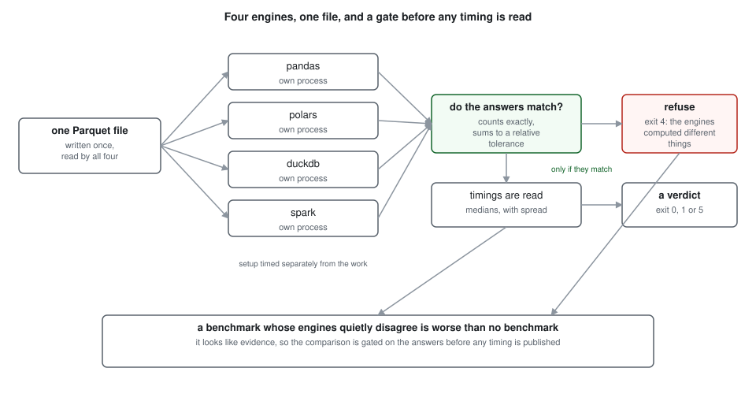
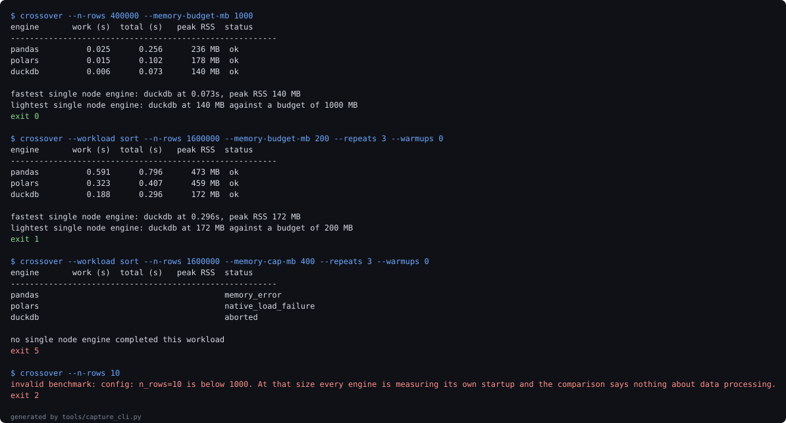

# spark-crossover

"Use Spark when the data is big" contains no number. This measures the number.

Four engines, four workloads, four data sizes, every engine reading the same Parquet bytes
and checked against the others to confirm it computed the same answer before any timing is
read. The headline result is that the crossover is not where the advice implies, and on
one machine it is not reachable at all.

Everything below comes from a recorded run on a two core machine, reproduced by `make
bench`. The numbers will differ on your hardware. That is the point of shipping the
harness rather than a leaderboard.



## Spark starts in debt

Before any data is touched, a JVM has to come up.

| engine | setup (s) | floor (s) |
| --- | --- | --- |
| pandas | 0.210 | 0.220 |
| polars | 0.096 | 0.099 |
| duckdb | 0.057 | 0.058 |
| spark | 5.611 | 6.349 |

Nothing finishes in Spark in under 6.35s on this machine, with 5.61s of that spent before
the first row is read. DuckDB's floor of 0.058s is 109 times lower. Every workload DuckDB
completes faster than Spark's floor is a workload Spark cannot win, whatever happens inside
the engine.

## No crossover, anywhere a single machine can reach

Grouped aggregation, median work time in seconds, setup excluded so Spark is given the
benefit of a warm session:

| rows | pandas | polars | duckdb | spark |
| --- | --- | --- | --- | --- |
| 100,000 | 0.011 | 0.006 | 0.004 | 0.539 |
| 400,000 | 0.023 | 0.013 | 0.005 | 0.596 |
| 1,600,000 | 0.093 | 0.030 | 0.014 | 0.654 |
| 6,400,000 | 0.300 | 0.108 | 0.042 | 0.870 |

Spark's work time divided by the best single node engine's:

| rows | ratio |
| --- | --- |
| 100,000 | 152.9 |
| 400,000 | 114.7 |
| 1,600,000 | 47.8 |
| 6,400,000 | 20.6 |

The gap closes steadily, from 153 times slower at the smallest size to 20.6x slower at the
largest size measured, 6,400,000 rows, so it closes by 7.4x across a 64 fold increase in
data. A crossover exists. It is not here.

Fitting the ratio against size as a power law gives an exponent of -0.497, close enough to
an inverse square root to be suggestive, which puts break even near 3.5 billion rows.

That number should not be believed, and it is printed with that warning attached in the
experiment itself. It extrapolates four points three orders of magnitude past the measured
range, to a size this machine cannot hold. It is reported because its absurdity is the
finding: on speed alone the question does not resolve anywhere near the sizes a single
machine deals with. Speed is the wrong axis.

## The experiment that refuted me

I expected the engine rankings to change between operations, and planned to argue that no
single row count could answer the question because the winner itself depends on the work.

It did not happen. All four at 1,600,000 rows:

| workload | pandas | polars | duckdb | spark |
| --- | --- | --- | --- | --- |
| groupby | 0.075 | 0.043 | 0.013 | 0.619 |
| join | 0.188 | 0.052 | 0.032 | 1.417 |
| sort | 0.606 | 0.231 | 0.170 | 3.507 |
| distinct | 0.132 | 0.075 | 0.030 | 0.736 |

DuckDB wins every operation, and the single node engines finish in 1 ordering across all
four. The guess was wrong, and the experiment is written up as it ran.

The conclusion survives by a different route. Spark's deficit varies by workload:

| workload | spark is slower by |
| --- | --- |
| groupby | 47.2 |
| join | 43.9 |
| sort | 20.6 |
| distinct | 24.4 |

A spread of 2.3x at one fixed size. Since the deficit differs per operation, the row count
at which Spark would catch up differs per operation too. There is still no single N behind
"switch above N rows", just not for the reason I expected.

## The axis that actually matters

Teams do not usually reach for a cluster because pandas was slow. They reach for it because
pandas died. So: cap the address space available to the process and ask who still finishes
a 6,400,000 row sort.

| engine | peak RSS (MB) | work (s) | lowest cap survived |
| --- | --- | --- | --- |
| pandas | 1085 | 4.01 | 3000 MB |
| polars | 1068 | 1.68 | 6000 MB |
| duckdb | 252 | 0.63 | 750 MB |
| spark | 154 | 11.34 | not measurable |

DuckDB completes the sort under a 750 MB cap. pandas needs 3000 MB before it finishes the
same work, four times as much, and polars needs 6000 MB despite using no more resident
memory than pandas: it reserves address space far beyond what it touches, and a hard cap
counts the reservation.

Spark is marked not measurable rather than failed. The JVM reserves address space the same
way and more so, and fails to start under caps it would have run under comfortably. Scoring
that as a loss would publish a result that is not true. What is true, and in Spark's
favour, is the first column: spark uses 154 MB for this sort, the least of any engine here,
because it was built not to hold the data. That is a real engineering property and the
honest case for it.

The uncomfortable conclusion is that the property is available without a cluster. DuckDB
clears the same memory cliff on one machine, at a fifth of the memory pandas needs and
roughly eighteen times faster than Spark on the same sort.

## How they fail is not the same either

| cap | pandas | polars | duckdb | spark |
| --- | --- | --- | --- | --- |
| 750 MB | memory_error | memory_error | ok | not measurable |
| 1500 MB | memory_error | aborted | ok | not measurable |
| 3000 MB | ok | aborted | ok | not measurable |
| 6000 MB | ok | ok | ok | ok |

Only `MemoryError` is something your code can catch. `aborted` means the process was killed
by a signal, so any retry has to live outside it. Polars can fail stranger still: under a
tight cap its native library fails to map and the first symptom is a `NameError` about an
undefined symbol, which reads like a broken installation rather than a memory limit.

Which allocation fails first is not deterministic. The same cell reported `MemoryError` on
one run and a different allocation failure on the next, which is why the raw error text is
recorded per cell. An engine that fails differently each time is one you cannot write a
reliable handler for.

## How much of this is noise

Across separate process launches the same measurement varies by up to 1.27 on this machine,
and a derived ratio of ratios moved considerably more than that between two runs of the
same experiment. Every conclusion here therefore rests on gaps of tens of times, never on
small differences, and no figure in this README should be read to more precision than it
was measured with.

This is also why `make verify` does not rerun the benchmarks. A check that re-measures a
non-deterministic quantity and demands it match the published figure fails at random, and a
check that fails at random is a check everybody learns to ignore. The timings are recorded
in `docs/experiments/`, `make bench` regenerates them deliberately, and the diff then shows
exactly which published figures moved. [ADR-003](docs/adr/ADR-003-what-verify-rechecks.md)
has the reasoning.

## Using it

```bash
make install          # see the note on setuptools below
make verify           # tests, lint, and the figure check, no benchmarks
make bench            # rerun the four experiments and rewrite docs/experiments
crossover --workload sort --n-rows 5000000 --memory-budget-mb 2000
```



That image is generated from stdout captured at generation time, and
`docs/evidence-manifest.json` records each command with the exit code it actually
returned. It is not byte reproducible, because it contains real timings and those move
between runs; the exit codes are, and they are what the manifest exists to let you check.

`--memory-budget-mb` is the memory the target machine has, and the verdict compares it
against measured peak resident memory. `--memory-cap-mb` is a separate flag that applies a
hard address space cap to each measurement. They were one flag until trying to demonstrate
exit 1 showed it could never fire: surviving a cap requires a cap far above what an engine
resides in, so the measured peak was always a small fraction of the number it was compared
against. Two questions had been given one knob.

The CLI answers one question: does this workload need more than one machine?

| code | meaning |
| --- | --- |
| 0 | at least one single node engine finished inside the budget |
| 1 | finished, but close enough to the budget to be worth watching |
| 2 | benchmark configuration rejected |
| 3 | internal error |
| 4 | the engines disagreed on the answer, so the timings mean nothing |
| 5 | no single node engine finished this workload inside the budget |

Exit 5 is the only honest machine readable case for a cluster. Exit 4 is what protects the
rest: a benchmark whose engines quietly computed different things is worse than no
benchmark, because it looks like evidence.

## Installing

PySpark still ships a legacy `setup.py` that reaches for `install_layout`, which newer
setuptools removed. On a Debian patched interpreter the build fails with an
`AttributeError` naming neither Spark nor setuptools. Build requirements pin setuptools
below 81, and a clean virtual environment avoids the distribution's patched copy:

```bash
python3 -m venv .venv
.venv/bin/pip install --upgrade "setuptools<81" wheel
.venv/bin/pip install -e ".[dev]"
```

Java 17 or 21 is required for Spark 4. [ADR-001](docs/adr/ADR-001-pinned-build-toolchain.md)
has the full diagnosis.

## Verification

The two kinds of figure in this repository are checked differently, deliberately. The suite
figures are deterministic and re-measured on every run. The timings are read from the
recorded run. Both are registered in `docs/metrics.json` with anchor phrases and checked in
both directions: every metric must appear in the prose through its anchor, and every
decimal in the prose must correspond to a metric.

The suite is 86 tests at 99 percent line coverage. The 3 lines not covered apply the memory
cap inside a measurement subprocess, where the parent process's coverage cannot follow;
they are verified from outside instead, by asserting the limit is really set and that a
real workload fails under a cap too small for it.

## What this cannot measure

A local Spark session is not a cluster, and this repository never claims to have measured
one. [ADR-005](docs/adr/ADR-005-what-this-cannot-measure.md) is the full list: no network
shuffle, no distributed storage, no multi node fault tolerance, one machine, two cores, one
data distribution, and four workloads chosen before the results were known.

What it does support is narrower and still worth saying. The fixed cost of a distributed
engine is real and measurable; on a single machine it is not repaid at any size that
machine can hold; and the memory wall that usually motivates the move can be cleared by a
better single node engine.


## Layout

```
src/spark_crossover/   config, data, workloads, engines, agreement, runner, timing, cli
experiments/           the four experiments, writing JSON to docs/experiments/
tests/                 86 tests
tools/                 metric collection and the two-direction number checker
docs/adr/              five decision records
```
